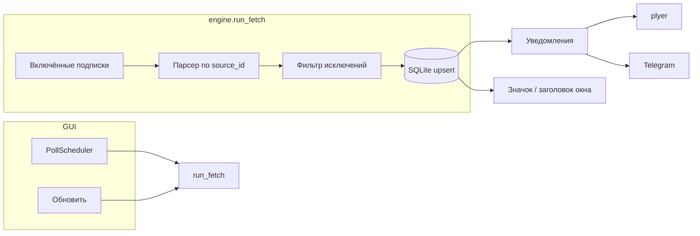

# JobDesk — документация

**Версия приложения:** 0.1.0  
**Назначение:** мониторинг IT-вакансий с нескольких сайтов: подписки, база, опрос источников, уведомления. Есть **десктоп** (`python main.py`) и **веб** (Laravel + Vue SPA) — см. [WEB.md](WEB.md).

---

## Содержание

1. [Требования и установка](#требования-и-установка)
2. [Запуск](#запуск)
3. [Интерфейс](#интерфейс)
4. [Подписки](#подписки)
5. [Источники вакансий](#источники-вакансий)
6. [Настройки и переменные окружения](#настройки-и-переменные-окружения)
7. [Данные и хранение](#данные-и-хранение)
8. [Как работает обновление](#как-работает-обновление)
9. [Уведомления](#уведомления)
10. [Архитектура проекта](#архитектура-проекта)
11. [Добавление нового сайта](#добавление-нового-сайта)
12. [Правила работы](#правила-работы)
13. [Устранение неполадок](#устранение-неполадок)

---

## Требования и установка

| Компонент | Версия |
|-----------|--------|
| Python | 3.11+ (проверено на 3.12) |
| ОС | Windows (уведомления через `plyer`; GUI — CustomTkinter) |

```bash
cd d:\_PHPStormProjects\Job
pip install -r requirements.txt
```

Зависимости:

- `customtkinter` — интерфейс
- `feedparser` — RSS/Atom
- `beautifulsoup4`, `lxml` — HTML-парсинг
- `plyer` — системные уведомления
- `certifi` — корректная проверка SSL (SuperJob и др.)

---

## Запуск

```bash
python main.py
```

Точка входа: `main.py` → `jobdesk.gui.app.run_app()`.

Подписки **не создаются автоматически** — добавьте их на вкладке «Подписки» (источник + запрос), иначе «Обновить с сайтов» сообщит, что нет включённых подписок.

---

## Интерфейс

### Вкладка «Желаемая работа»

| Элемент | Действие |
|---------|----------|
| Текстовое поле | Описание идеальной вакансии (роль, стек, формат, город и т.д.) |
| **Сохранить** | Запись в SQLite (`desired_vacancy`); при следующем запуске подставляется автоматически |
| **Сохранить и искать** | Сохранить и сразу опросить все включённые подписки |
| Чекбокс | **Искать по описанию** — запрос на сайтах из технологий (в т.ч. из скобок) + мягкий фильтр (достаточно одного совпадения по стеку) |

На вкладке «Вакансии»: **🆕** — новая, **✓** — просмотренная (приглушённый текст, в метаданных «Просмотрена»).

Логика: `jobdesk/desired.py` + `engine.run_fetch`.

### Вкладка «Вакансии»

| Элемент | Действие |
|---------|----------|
| **Обновить** | Запускает проверку всех включённых подписок (в фоновом потоке) |
| **Отметить все просмотренными** | Сбрасывает флаг «новая» у всех вакансий |
| **Только новые** | Фильтр списка |
| **Открыть** | Открывает URL вакансии в браузере |
| **Просмотрено** | Снимает метку «новая» с одной записи |

Счётчик **«Новых: N»** — число записей с `is_new = 1` в базе.

### Вкладка «Подписки»

Форма добавления подписки:

| Поле | Описание |
|------|----------|
| **Название** | Произвольная метка (для списка и ошибок) |
| **Источник** | Один из зарегистрированных парсеров (20 источников) |
| **Запрос** | Зависит от источника — см. [таблицу](#источники-вакансий) и подсказку под полем |
| **Исключить слова** | Через запятую, точку с запятой или перенос строки; если слово встречается в названии, компании или описании — вакансия отбрасывается |

У каждой подписки в списке:

- **Вкл/выкл** — участвует ли в автопроверке
- **Сейчас** — обновить только эту подписку
- **Удалить** — удалить подписку (вакансии в базе остаются)

### Вкладка «Источники»

Справочник всех сайтов и кратких подсказок к полю «Запрос», плюс список сайтов без встроенного парсера.

### Вкладка «Настройки»

| Параметр | По умолчанию | Описание |
|----------|--------------|----------|
| **Интервал проверки (мин)** | 15 | Минимум 1 мин, максимум 1440 (24 ч). После сохранения таймер перепланируется |

---

## Подписки

Подписка — связка **источник + запрос + фильтр исключений**. Одна и та же вакансия с разных источников хранится **отдельно** (ключ дедупликации: `source:external_id`).

**Рекомендации:**

- Для Хабра предпочтительнее **RSS** (`habr_rss`): меньше нагрузка на сайт, стабильные `guid`.
- Для hh.ru при проблемах с API используйте **HTML** (`hh_html`).
- Для удалёнки на английском: `remotive_api`, `jobicy_api`, `wwr_rss`.
- Несколько подписок с разными запросами на один источник — поддерживается.

---

## Источники вакансий

<!-- jobdesk:sources:auto -->
Всего **20** встроенных парсеров (обновлено скриптом `tools/update_docs.py`).

Внутренний ID (`source_id`) сохраняется в базе в поле `source`.

### Россия

| ID | Название в UI | Поле «Запрос» |
|----|---------------|---------------|
| `geekjob_html` | 🇷🇺 GeekJob (HTML) | Параметр q |
| `hh_api` | 🇷🇺 HeadHunter (API → HTML fallback) | Текст поиска; при ошибке API — автоматически HTML. JOBDESK_HH_USER_AGENT=App/1.0 (email) |
| `hh_html` | 🇷🇺 HeadHunter / hh.ru (HTML) | Текст поиска, как на hh.ru |
| `rabota_html` | 🇷🇺 Rabota.ru (HTML) | Строка query |
| `superjob_html` | 🇷🇺 SuperJob (HTML) | Ключевые слова (keywords) |
| `zarplata_html` | 🇷🇺 Zarplata.ru (HTML) | Текст поиска, как на zarplata.ru |
| `trudvsem_api` | 🇷🇺 Работа России / Трудвсем (API) | Текст для opendata.trudvsem.ru |

### Украина

| ID | Название в UI | Поле «Запрос» |
|----|---------------|---------------|
| `djini_html` | 🇺🇦 Djini (HTML) | keywords |
| `dou_html` | 🇺🇦 DOU (HTML) | search — строка поиска |
| `dou_rss` | 🇺🇦 DOU (RSS) | search или пусто (вся лента) |

### Беларусь

| ID | Название в UI | Поле «Запрос» |
|----|---------------|---------------|
| `devby_html` | 🇧🇾 Dev.by (HTML) | search |

### Удалённая работа / международные API

| ID | Название в UI | Поле «Запрос» |
|----|---------------|---------------|
| `arbeitnow_api` | 🌍 Arbeitnow (API) | Локальный фильтр по запросу (опционально) |
| `himalayas_api` | 🌍 Himalayas (API) | search (англ., опционально) |
| `jobicy_api` | 🌍 Jobicy (API) | tag (например python, devops) |
| `remoteok_api` | 🌍 Remote OK (API) | Фильтр по словам в названии/компании (опционально) |
| `remotive_api` | 🌍 Remotive (API) | search (англ.) |
| `wwr_rss` | 🌍 We Work Remotely (RSS) | programming \| devops \| design \| all или URL RSS |

### Универсальный

| ID | Название в UI | Поле «Запрос» |
|----|---------------|---------------|
| `rss_custom` | 📡 Произвольный RSS | Полный URL RSS/Atom |

### Прочее

| ID | Название в UI | Поле «Запрос» |
|----|---------------|---------------|
| `habr_html` | Хабр Карьера (HTML) | Текст q для страницы вакансий |
| `habr_rss` | Хабр Карьера (RSS) | Текст q, как на career.habr.com (например: python remote) |

### Без встроенного парсера

Сайты без стабильного публичного API/RSS в этой версии:

Getmatch (SPA), LinkedIn, Indeed, Jooble (антибот), Хабр Q&A.

Их можно подключить через «Произвольный RSS», если найдёте ленту.

<!-- /jobdesk:sources:auto -->

---

## Настройки и переменные окружения

### В приложении

- **Интервал проверки** — хранится в SQLite (`settings.poll_interval_minutes`).

### Файл `.env`

Скопируйте [.env.example](../.env.example) в `.env` в корне проекта. **Читает только** `jobdesk/config.py` при старте (`main.py` → `ensure_env_loaded()`).

| Переменная | Назначение |
|------------|------------|
| `BOT` | ID чата Telegram (личный или группы) |
| `BOT_NAME` | Подпись в сообщениях бота |
| `BOT_TOKEN` | Токен от [@BotFather](https://t.me/BotFather) |
| `JOBDESK_HH_USER_AGENT` | User-Agent для `api.hh.ru` ([правила HH](https://github.com/hhru/api)) |

Telegram **включён**, если заданы и `BOT`, и `BOT_TOKEN`. Статус — на вкладке «Настройки» (без показа секретов).

**Правило для разработки и AI:** не открывать и не цитировать `.env`; шаблон — только `.env.example`. См. `.cursor/rules/jobdesk-secrets.mdc`.

---

## Данные и хранение

### Расположение

| Данные | Путь |
|--------|------|
| База SQLite | `%LOCALAPPDATA%\JobDesk\jobdesk.db` |
| Каталог данных | `%LOCALAPPDATA%\JobDesk\` |

Если `LOCALAPPDATA` недоступен: `~/.jobdesk/jobdesk.db`.

### Схема базы (упрощённо)

**`subscriptions`** — подписки пользователя.

**`vacancies`** — найденные вакансии:

- `dedupe_key` — уникальный ключ `source:external_id`
- `is_new` — 1 = ещё не просмотрена в приложении
- `first_seen_at` — когда впервые увидели
- `published_at` — дата с сайта (если парсер передал)

**`settings`** — ключ–значение (интервал опроса).

Проектные файлы `_probe*.py`, `_habr_sample.html` — отладочные, на работу приложения не влияют.

---

## Как работает обновление



1. При запуске и по **таймеру** (вкладка «Настройки») опрашиваются все **включённые** подписки — все подключённые сайты из списка.
2. Результат фильтруется по **исключающим словам** (требования подписки).
3. Новые `dedupe_key` вставляются с `is_new = 1`; существующие обновляют title/company/url/description.
4. Ошибки по подпискам собираются в строку статуса (не останавливают остальные).
5. Если за этот опрос появились **новые подходящие** вакансии: toast Windows, сообщение в Telegram (если настроен `.env`), обновление **значка/заголовка** с числом **непросмотренных** (`is_new = 1`).

Минимальный интервал между срабатываниями таймера — **30 секунд** (внутренний предел планировщика). Через ~1,5 с после старта выполняется первый опрос.

---

## Уведомления

| Канал | Модуль | Когда |
|-------|--------|--------|
| Заголовок окна + иконка | `jobdesk/app_badge.py` | Всегда при изменении числа непросмотренных |
| Windows toast | `jobdesk/notify.py` | После опроса, если есть **новые** вакансии по подпискам |
| Telegram | `jobdesk/telegram_notify.py` | Те же новые вакансии, если в `.env` заданы `BOT` + `BOT_TOKEN` |

Toast показывает, сколько вакансий пришло **за этот опрос**, и сколько **непросмотренных всего** в базе.

Telegram: до 15 вакансий в одном сообщении (название, компания, ссылка). Отправка в фоне, не блокирует GUI.

Если toast не появляются — настройки уведомлений Windows для Python. Telegram — проверьте chat id (`BOT`) и что вы написали боту `/start`.

---

## Архитектура проекта

```
Job/
├── main.py                 # Запуск GUI
├── requirements.txt
├── docs/
│   └── JobDesk.md          # Эта документация
└── jobdesk/
    ├── gui/app.py          # CustomTkinter: вкладки, потоки
    ├── db.py               # SQLite
    ├── engine.py           # Оркестрация опроса
    ├── scheduler.py        # threading.Timer
    ├── config.py           # единственный читатель .env
    ├── notify.py           # desktop после опроса
    ├── telegram_notify.py  # Telegram Bot API
    ├── app_badge.py        # иконка / заголовок с счётчиком
    ├── http_client.py      # HTTP + SSL (certifi)
    ├── models.py           # Vacancy, Subscription
    ├── paths.py            # Путь к БД
    └── parsers/
        ├── base.py         # JobParser, реестр
        ├── register.py     # Список всех парсеров
        ├── source_notes.py # Подсказки для UI
        ├── habr_*.py       # Хабр
        ├── hh.py           # HH / Zarplata
        ├── russia.py       # SuperJob, Rabota, Трудвсем
        ├── cis.py          # DOU, Djini, Dev.by, GeekJob
        ├── remote.py       # Remote OK, Remotive, …
        ├── rss_generic.py  # RSS, WWR, custom
        └── common.py       # Общие хелперы
```

**Расширяемость:** каждый источник — класс с `source_id`, `display_name` и методом `fetch(subscription) -> list[Vacancy]`.

---

## Добавление нового сайта

1. Создайте файл в `jobdesk/parsers/`, например `my_site.py`:

```python
from jobdesk.models import Subscription, Vacancy
from jobdesk.parsers.base import JobParser
from jobdesk.parsers.common import make_vacancy

class MySiteParser(JobParser):
    source_id = "mysite_html"
    display_name = "MySite (HTML)"

    def fetch(self, subscription: Subscription) -> list[Vacancy]:
        # загрузка + разбор
        return [
            make_vacancy(
                source=self.source_id,
                external_id="123",
                title="...",
                url="https://...",
                company="...",
                subscription=subscription,
            )
        ]
```

2. Зарегистрируйте класс в `jobdesk/parsers/register.py` (`ALL_PARSERS`).
3. Добавьте подсказку в `jobdesk/parsers/source_notes.py` → `SOURCE_QUERY_HINT`.
4. Выполните `python tools/update_docs.py` — обновится таблица источников в этой документации и счётчик в README.
5. Перезапустите приложение.

---

## Правила работы

Правила для **пользователей** приложения и для **разработчиков** (в т.ч. Cursor AI). Конфигурация агента: `.cursor/rules/jobdesk-workflow.mdc`, `.cursor/rules/jobdesk-parsers.mdc`, `.cursor/rules/jobdesk-secrets.mdc`.

### Для пользователя

| Правило | Пояснение |
|---------|-----------|
| Личный мониторинг | JobDesk рассчитан на разумную частоту опроса для своих подписок, не на массовый scraping |
| Интервал **≥ 15 мин** | Для HTML-источников; меньше — риск блокировки IP |
| API/RSS в приоритете | `habr_rss`, `hh_api`, `trudvsem_api`, `dou_rss` и т.п. — предпочтительнее HTML |
| robots.txt и ToS | Соблюдайте правила каждого сайта |
| HH API | Нужен корректный `JOBDESK_HH_USER_AGENT`; иначе — `hh_html` |
| Исключения в подписке | Поле «Исключить слова» — фильтр по title/company/description после загрузки |

### Для разработчика

| Правило | Пояснение |
|---------|-----------|
| **Синхронизация документации** | После изменений парсеров или версии — всегда `python tools/update_docs.py` |
| Единый реестр | Список сайтов только через `register.py` + `SOURCE_QUERY_HINT`; не дублировать таблицы вручную |
| Автоблок в доке | Между `<!-- jobdesk:sources:auto -->` — генерируется скриптом, не править руками |
| Минимальный diff | Одна задача — один focused change; не смешивать рефакторинг с фичей |
| Парсеры | `JobParser` + `make_vacancy()` + `http_client`; стабильный `external_id` |
| Секреты | Не коммитить `.env`; **не читать `.env` вручную/AI** — только `jobdesk/config.py` |
| Telegram / badge | Логика в `notify.py`, `telegram_notify.py`, `app_badge.py`; описание — § «Уведомления» |
| Пробы | Файлы `_probe*.py` — локальная отладка, не часть релиза |

### Что обновлять при изменениях

| Тип изменения | Файлы |
|---------------|--------|
| Новый/удалённый источник | `jobdesk/parsers/*.py`, `register.py`, `source_notes.py` → **`python tools/update_docs.py`** |
| Версия приложения | `jobdesk/__init__.py` → **`python tools/update_docs.py`** |
| GUI, БД, scheduler, notify | `docs/JobDesk.md` (разделы «Интерфейс», «Данные», «Архитектура») вручную |
| Зависимости | `requirements.txt` + § «Требования и установка» |
| Переменные окружения | `http_client.py` / код + § «Настройки и переменные окружения» |

### Команда синхронизации

```bash
python tools/update_docs.py
```

Скрипт обновляет: таблицу источников в `docs/JobDesk.md`, строку версии, заголовок «Подключённые источники (N)» в `README.md`.

---

## Устранение неполадок

| Симптом | Что сделать |
|---------|-------------|
| `hh_api`: 403 / forbidden | Задайте `JOBDESK_HH_USER_AGENT` или переключитесь на `hh_html` |
| SuperJob / SSL ошибка | Обновите `certifi`: `pip install -U certifi` |
| Пустой список после обновления | Проверьте запрос, вкл/выкл подписки, строку статуса внизу окна |
| Getmatch / LinkedIn пусто | Нет HTML/API парсера — только RSS через `rss_custom` |
| Ошибка импорта GUI | `pip install -r requirements.txt` |
| Дубликаты с разных источников | Ожидаемо: разные `source_id` — разные записи |

---

## Связанные файлы

- Краткий обзор: [README.md](../README.md)
- Версия пакета: `jobdesk/__init__.py` → `__version__`
- Синхронизация доки: [tools/update_docs.py](../tools/update_docs.py)
- Правила Cursor: [.cursor/rules/](../.cursor/rules/)
